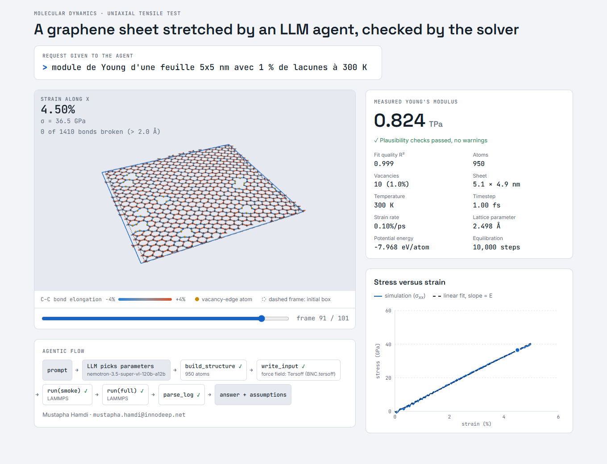
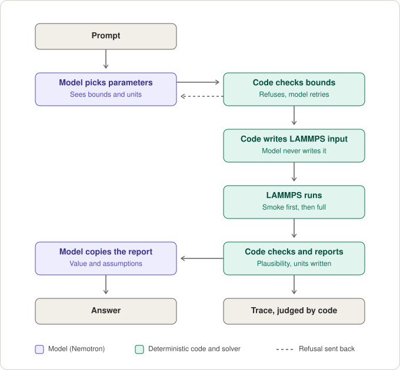

# graphene_agent (v0)

An LLM agent that drives LAMMPS on a graphene sheet: relaxation and uniaxial tension
(Young's modulus).

Interactive 3D demo: https://hamdim99.github.io/nemotron-lammps/

## Principle: the LLM proposes, the code verifies

- The model only has 4 bounded tools: `build_structure`, `write_input`, `run`, `parse_log`.
- It never writes a LAMMPS input: it picks parameters, the code generates the file.
- The tool schema announces the bounds and units; the code still checks every call.
- `parse_log` returns the assumptions already written out, units included; the model copies them.
- All validation is deterministic: hard-coded bounds (`BOUNDS`, `MAX_ATOMS`), LAMMPS itself,
  then physical plausibility checks (`PLAUSIBLE`).
- A `full` run is refused until a `smoke` run (200 steps) has succeeded on the same input.
- Every tool call and the final answer are logged to `<workdir>/trace.jsonl`.

## Installation

Python 3.10+ and LAMMPS with the MANYBODY package (`BNC.tersoff`, `CH.airebo` potentials).

Linux / macOS:

    conda install -c conda-forge lammps
    pip install openai pytest

Windows (conda-forge does not ship LAMMPS for win-64):

    pip install lammps openai pytest
    winget install Microsoft.msmpi

The Microsoft MPI runtime is required: without `msmpi.dll`, `lmp.exe` exits silently
(code 0xC0000135) and the agent reports "aucune sortie thermo dans le log".

The potential file is searched in `$LAMMPS_POTENTIALS`, in the `lammps` Python package,
next to the `lmp` executable, then in the current directory.

## Usage

Deterministic pipeline, no LLM (to check LAMMPS and the guardrails):

    python graphene_agent.py --spec spec.json

Agent (OpenAI-compatible API, NVIDIA endpoint by default):

    export NVIDIA_API_KEY=...        # PowerShell: $env:NVIDIA_API_KEY = "..."
    python graphene_agent.py "module de Young d'une feuille 5x5 nm avec 1 % de lacunes à 300 K" --workdir runs/essai

Optional variables: `NEMOTRON_MODEL` (default `nvidia/nemotron-3.5-super-vl-120b-a12b`),
`LLM_BASE_URL`. The key must never be written to a file.

The system prompt, the tool messages and the test prompts are in French.

Files written to the working directory: `graphene.data`, `in.<mode>.lammps`,
`log.<mode>.lammps`, `traj.<mode>.lammpstrj` (about 100 frames of the pull, for
visualisation) and `trace.jsonl`.

Tests:

    pytest             # guardrails, parse_thermo, agent loop with a scripted fake model (a few seconds)
    pytest -m slow     # real LAMMPS integration (~30 s)

3D interface (three.js) of a tensile run made by the agent, and video:

    python viewer/build_viewer.py runs/essai    # writes viewer/graphene_viewer.html and docs/index.html (standalone pages)
    python viewer/make_video.py                 # writes viewer/graphene_traction.mp4 (headless Edge/Chrome + imageio-ffmpeg)

`docs/index.html` is the page to share: on GitHub, enabling Pages (Settings > Pages, branch `main`,
folder `/docs`) publishes it at `https://<account>.github.io/<repo>/`.

Benchmark (30 cases in `bench/cases.json`, deterministic judge reading `trace.jsonl`):

    python bench/run_bench.py                   # resumes where it stopped; waits and retries on 429
    python bench/run_bench.py --judge-only      # re-judges existing traces without calling the model
    python bench/run_bench.py --check-units --label v2 --runs-dir runs_v2   # stricter judge, separate outputs

Outputs: `bench/results[_<label>].csv`, `bench/summary[_<label>].txt`, `bench/<runs-dir>/<id>/`.

## Reference results

Tersoff (`BNC.tersoff`), 300 K, LAMMPS 22Jul2025.

| Case | Parameters | Young's modulus | Source |
|---|---|---|---|
| 5x5 nm, pristine | dt 1 fs, 3000 equilibration steps, 0.005 /ps, max strain 2 % | 0.956 TPa (R² 0.996) | `--spec`, re-run on Windows (Update 4) |
| 5x5 nm, 2 % vacancies | same parameters | 0.798 TPa | initial validation, not re-run here |
| 5x5 nm, 1 % vacancies, seed 42 | dt 0.1 fs, 10,000 steps, 0.01 /ps, max strain 5 % (chosen by the model) | 0.825 TPa (R² 0.999) | real Nemotron agent |

Experimental reference: E ≈ 1.0 TPa for pristine graphene, a ≈ 2.46 Å. Tersoff gives
a = 2.492 Å here.

## Benchmark results

30 cases run through the real agent loop (Nemotron 3.5 Super VL, base model) and judged by code
from `trace.jsonl`, never by an LLM. Cases and expected outcomes were written before the run and
not changed afterwards. Raw score: **29 / 30** (49 minutes, no rate-limit wait).

| Category | Passed | Mean corrections | What is expected |
|---|---|---|---|
| Nominal | 9 / 9 | 0.44 | plausible result, requested parameters respected |
| To be corrected | 6 / 6 | 0.83 | plausible result after correction |
| Incomplete | 5 / 5 | 0.60 | result with the assumptions stated |
| Out of bounds | 5 / 5 | 1.20 | refusal reported, no silent reduction |
| Out of scope | 4 / 5 | 0.00 | refusal without an invented number |

The only failure (P04) declines to compute the phonon G mode, then quotes a literature value
(~1580 cm⁻¹) that did not come from the tools.

Read the score with these caveats, all visible in the traces:

- **Unit errors the judge does not check**: 11 of the 19 tensile write-ups state the strain rate
  as "0.01 %/ps" when the tool received 0.01 /ps, a factor of one hundred.
- **The "to be corrected" category is weak**: 2 fs, 1.8 fs, 500 equilibration steps and 0.5 %
  max strain all ran unchanged and passed. Only C06 (2 fs at 1500 K) diverged and was corrected.
  C05 (0.5 % strain) gives 1.025 TPa with R² 0.976: inside the range, but the least reliable value.
- **Most corrections come from the model itself**: it asks for 10 to 20 % max strain, which the
  code rejects, then retries at 5 %.
- **Two unrequested reductions** (B03, B05): the model re-ran with a reduced value and said so,
  where B01, B02 and B04 stopped and asked.
- The range for sheets with vacancies ([0.4, 1.0] TPa) belongs to the benchmark, not to the agent.

Full table: `bench/results.csv`.

### Version 2: units written by the code, bounds in the schema

Three changes to the agent, then the same 30 cases again:

- `parse_log` writes the assumptions with their units and the model copies them;
- the tool schema exposes the parameter bounds and units;
- the timestep description gives a usual range (0.5 to 1 fs for carbon at room temperature).

The judge gained a unit check (`--check-units`): a strain rate quoted in the wrong unit is a failure.
Both runs below are scored with that stricter judge.

| | Version 1 | Version 2 |
|---|---|---|
| **Overall** | 18 / 30 | **28 / 30** |
| Nominal | 5 / 9 | 9 / 9 |
| To be corrected | 4 / 6 | 6 / 6 |
| Incomplete | 2 / 5 | 4 / 5 |
| Out of bounds | 3 / 5 | 4 / 5 |
| Out of scope | 4 / 5 | 5 / 5 |
| Unit errors | 11 | 0 |
| Corrections, total | 18 | 2 |
| Duration | 49 min | 111 min |

Version 1 under the original judge is the 29 / 30 above; the 11 extra failures are the unit errors.
The gain cannot be attributed to one change: all three were applied together.

The two version 2 failures:

- **I03**: on a vague request the model picked 2 % max strain on a sheet with 5 % vacancies, got
  R² = 0.899, passed on the code's warning, but did not re-run.
- **B05**: asked for a strain rate of 1 /ps, the model sent 0.01 /ps straight away and never said so.

B05 is the cost of exposing the bounds. In version 1 the model sent the out-of-bounds value, the
code refused and the refusal was in the trace. Now the model clamps before calling the tool, so the
code never sees the requested value. B01, B02 and B04 pass because the model declined openly, but
the judge marks them "refusal not verified by the tools". Corrections fell from 18 to 2; part of
the guarantee on refusals moved from the code to the model.

Runs are slower because the model, knowing the bounds, now picks a strain rate ten times lower.

Tables: `bench/results_v1_units.csv`, `bench/results_v2.csv`.

## Limitations

- **Classical potential** (Tersoff or AIREBO): values depend on the potential and are not
  a substitute for an ab initio calculation. The conventional 3.35 Å thickness enters the stress.
- **No electronic properties**: band gap, band structure and electronic doping are out of
  reach; the agent must say so without giving a number.
- **No thermal conductivity** in v0.
- **Linear regime only**: strain is capped at 5 %, so there is no fracture strength and no
  simulated fracture.
- The plausibility range for Young's modulus only applies to pristine sheets; with
  vacancies, only the R² of the fit is checked.
- Molecular-dynamics strain rates (10⁻⁴ to 10⁻² /ps), far above experiment; sheets of 1 to
  20 nm, 20,000 atoms at most, a single vacancy draw per seed.
- The model freely chooses any unspecified parameter within the bounds: read the
  assumptions in the answer and `trace.jsonl` rather than the number alone.
