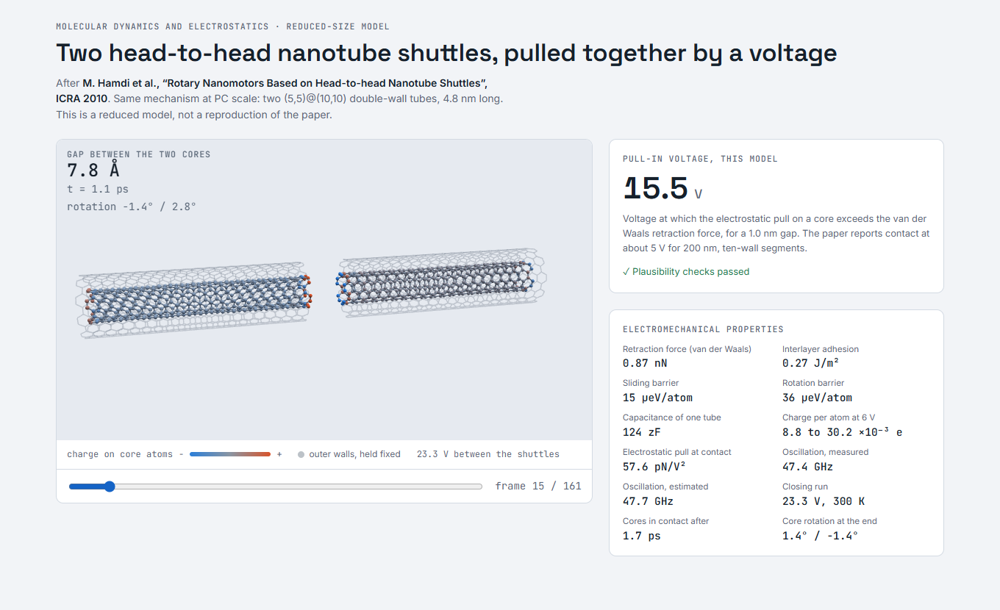
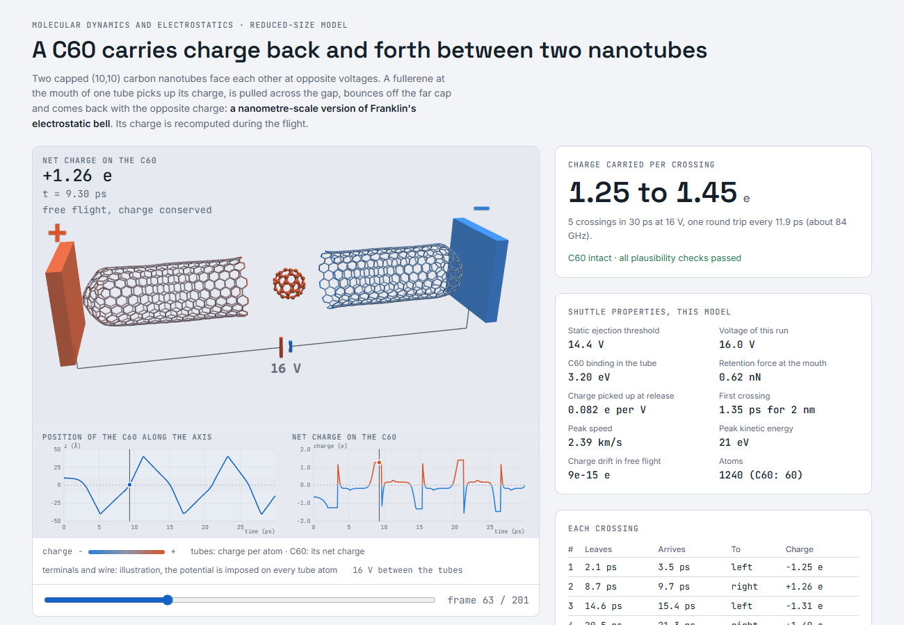

# graphene_agent (v0)

An LLM agent that drives LAMMPS on a graphene sheet: relaxation and uniaxial tension
(Young's modulus).

Interactive 3D demo: https://hamdim99.github.io/nemotron-lammps/

## Principle: the LLM proposes, the code verifies

- The model only has 4 bounded tools: `build_structure`, `write_input`, `run`, `parse_log`.
- It never writes a LAMMPS input: it picks parameters, the code generates the file.
- The tool schema announces the bounds and units; the code still checks every call.
- `parse_log` returns the assumptions already written out, units included; the model copies them.
- All validation is deterministic: hard-coded bounds (`BOUNDS`, `MAX_ATOMS`), LAMMPS itself,
  then physical plausibility checks (`PLAUSIBLE`).
- A `full` run is refused until a `smoke` run (200 steps) has succeeded on the same input.
- Every tool call and the final answer are logged to `<workdir>/trace.jsonl`.

## Installation

Python 3.10+ and LAMMPS with the MANYBODY package (`BNC.tersoff`, `CH.airebo` potentials).

Linux / macOS:

    conda install -c conda-forge lammps
    pip install openai pytest

Windows (conda-forge does not ship LAMMPS for win-64):

    pip install lammps openai pytest
    winget install Microsoft.msmpi

The Microsoft MPI runtime is required: without `msmpi.dll`, `lmp.exe` exits silently
(code 0xC0000135) and the agent reports "aucune sortie thermo dans le log".

The potential file is searched in `$LAMMPS_POTENTIALS`, in the `lammps` Python package,
next to the `lmp` executable, then in the current directory.

## Usage

Deterministic pipeline, no LLM (to check LAMMPS and the guardrails):

    python graphene_agent.py --spec spec.json

Agent (OpenAI-compatible API, NVIDIA endpoint by default):

    export NVIDIA_API_KEY=...        # PowerShell: $env:NVIDIA_API_KEY = "..."
    python graphene_agent.py "module de Young d'une feuille 5x5 nm avec 1 % de lacunes à 300 K" --workdir runs/essai

Optional variables: `NEMOTRON_MODEL` (default `nvidia/nemotron-3.5-super-vl-120b-a12b`),
`LLM_BASE_URL`. The key must never be written to a file.

The system prompt, the tool messages and the test prompts are in French.

Files written to the working directory: `graphene.data`, `in.<mode>.lammps`,
`log.<mode>.lammps`, `traj.<mode>.lammpstrj` (about 100 frames of the pull, for
visualisation) and `trace.jsonl`.

Tests:

    pytest             # guardrails, parse_thermo, agent loop with a scripted fake model (a few seconds)
    pytest -m slow     # real LAMMPS integration (~30 s)

3D interface (three.js) of a tensile run made by the agent, and video:

    python viewer/build_viewer.py runs/essai    # writes viewer/graphene_viewer.html and docs/index.html (standalone pages)
    python viewer/make_video.py                 # writes viewer/graphene_traction.mp4 (headless Edge/Chrome + imageio-ffmpeg)

`docs/index.html` is the page to share: on GitHub, enabling Pages (Settings > Pages, branch `main`,
folder `/docs`) publishes it at `https://<account>.github.io/<repo>/`.

Benchmark (30 cases in `bench/cases.json`, deterministic judge reading `trace.jsonl`):

    python bench/run_bench.py                   # resumes where it stopped; waits and retries on 429
    python bench/run_bench.py --judge-only      # re-judges existing traces without calling the model
    python bench/run_bench.py --check-units --label v2 --runs-dir runs_v2   # stricter judge, separate outputs

Outputs: `bench/results[_<label>].csv`, `bench/summary[_<label>].txt`, `bench/<runs-dir>/<id>/`.

## Reference results

Tersoff (`BNC.tersoff`), 300 K, LAMMPS 22Jul2025.

| Case | Parameters | Young's modulus | Source |
|---|---|---|---|
| 5x5 nm, pristine | dt 1 fs, 3000 equilibration steps, 0.005 /ps, max strain 2 % | 0.956 TPa (R² 0.996) | `--spec`, re-run on Windows (Update 4) |
| 5x5 nm, 2 % vacancies | same parameters | 0.798 TPa | initial validation, not re-run here |
| 5x5 nm, 1 % vacancies, seed 42 | dt 0.1 fs, 10,000 steps, 0.01 /ps, max strain 5 % (chosen by the model) | 0.825 TPa (R² 0.999) | real Nemotron agent, version 1 |
| 5x5 nm, 1 % vacancies, seed 42 | dt 1 fs, 10,000 steps, 0.001 /ps, max strain 5 % (chosen by the model) | 0.824 TPa (R² 0.999) | real Nemotron agent, version 2 (the run shown in the demo) |

Experimental reference: E ≈ 1.0 TPa for pristine graphene, a ≈ 2.46 Å. Tersoff gives
a = 2.492 Å here.

## Benchmark results

30 cases run through the real agent loop (Nemotron 3.5 Super VL, base model) and judged by code
from `trace.jsonl`, never by an LLM. Cases and expected outcomes were written before the first run
and have not been changed. One run per version, no rate-limit wait.

**Current agent (version 2): 28 / 30** under the strict judge, which also checks units.
The first version scores 18 / 30 under that same judge.

| Strict judge | Version 1 | Version 2 |
|---|---|---|
| **Overall** | 18 / 30 | **28 / 30** |
| Nominal | 5 / 9 | 9 / 9 |
| To be corrected | 4 / 6 | 6 / 6 |
| Incomplete | 2 / 5 | 4 / 5 |
| Out of bounds | 3 / 5 | 4 / 5 |
| Out of scope | 4 / 5 | 5 / 5 |
| Unit errors | 11 | 0 |
| Corrections, total | 18 | 2 |
| Duration | 49 min | 111 min |

### What changed in version 2

Three changes to the agent, applied together, so the gain cannot be attributed to one of them:

- `parse_log` writes the assumptions with their units and the model copies them;
- the tool schema exposes the parameter bounds and units (the bounds themselves are unchanged);
- the timestep description gives a usual range (0.5 to 1 fs for carbon at room temperature).
  This one mostly affects run time, not the score.

The judge gained a unit check (`--check-units`): a strain rate quoted in the wrong unit is a failure.
In version 1, 11 of the 19 tensile write-ups stated "0.01 %/ps" when the tool had received 0.01 /ps.

### The two version 2 failures

- **I03**: on a vague request the model picked 2 % max strain on a sheet with 5 % vacancies, got
  R² = 0.899, passed on the code's warning, but did not re-run. Re-run outside the benchmark with
  five vacancy draws (`bench/i03_seeds.py`): 0.60 ± 0.03 TPa at 5 % strain; the failed case is the
  lowest draw fitted over a 2 % window.
- **B05**: asked for a strain rate of 1 /ps, the model sent 0.01 /ps straight away and never said so.

### The cost of exposing the bounds

B05 is a side effect of the second change. In version 1 the model sent the out-of-bounds value, the
code refused and the refusal was in the trace. Now the model clamps before calling the tool, so the
code never sees the requested value. B01, B02 and B04 pass because the model declined openly, but
the judge marks them "refusal not verified by the tools". Corrections fell from 18 to 2; part of
the guarantee on refusals moved from the code to the model.

Runs are also slower: knowing the bounds, the model now picks a strain rate ten times lower.

### Version 1 under its original judge: 29 / 30

This is the first score that was published. The original judge did not check units, which is the
only reason it is higher than the 18 / 30 above: same answers, same traces, a less strict judge.

| Category | Passed | Mean corrections | What is expected |
|---|---|---|---|
| Nominal | 9 / 9 | 0.44 | plausible result, requested parameters respected |
| To be corrected | 6 / 6 | 0.83 | plausible result after correction |
| Incomplete | 5 / 5 | 0.60 | result with the assumptions stated |
| Out of bounds | 5 / 5 | 1.20 | refusal reported, no silent reduction |
| Out of scope | 4 / 5 | 0.00 | refusal without an invented number |

Its only failure (P04) declined to compute the phonon G mode, then quoted a literature value
(~1580 cm⁻¹) that did not come from the tools.

### Caveats that apply to both versions

- **The "to be corrected" category is weak**: 2 fs, 1.8 fs, 500 equilibration steps and 0.5 %
  max strain ran unchanged and passed. Only C06 (2 fs at 1500 K) diverged and was corrected.
  C05 (0.5 % strain) gives 1.025 TPa in version 1 and 0.894 TPa in version 2, with the lowest R²
  both times: inside the range, but mostly noise.
- **In version 1 most corrections came from the model itself**: it asked for 10 to 20 % max
  strain, which the code rejected, then retried at 5 %.
- The range for sheets with vacancies ([0.4, 1.0] TPa) belongs to the benchmark, not to the agent.
- A single run per case and per version: no error bars.

Tables: `bench/results_v2.csv` (version 2), `bench/results_v1_units.csv` (version 1, strict judge),
`bench/results.csv` (version 1, original judge).

## Nanotube shuttles: static electromechanical properties at reduced size

`nanotube_lab.py` applies the same rules (bounded parameters, code-written LAMMPS input, plausibility
checks) to the geometry of M. Hamdi et al., "Rotary Nanomotors Based on Head-to-head Nanotube
Shuttles", ICRA 2010: two double-wall nanotubes whose cores are pulled together by a voltage.
Deterministic pipeline, no LLM. It reports static properties only; see the note on rotation below.

Interactive page: https://hamdim99.github.io/nemotron-lammps/nanotube.html

    python nanotube_lab.py all                  # writes runs_nt/results.json
    python viewer/build_nanotube.py runs_nt     # writes docs/nanotube.html

**This is a reduced model, not a reproduction of the paper**: (5,5)@(10,10) tubes 4.8 nm long instead
of ten walls and 200 nm, rigid shells in the static scans.

| Property | Value | How |
|---|---|---|
| Interlayer spacing | 3.39 Å | geometry |
| Retraction force (van der Waals) | 0.87 nN | slope of the energy as the core is pulled out, AIREBO with LJ |
| Interlayer adhesion | 0.27 J/m² | same slope per unit area |
| Sliding / rotation barrier | 15 / 36 µeV per atom | rigid shells, infinite tube |
| Charge per atom at 6 V | 8.8 to 30.2 ×10⁻³ e | atomistic moment method, averaged per axial cell |
| Capacitance of one tube | 0.124 aF | total charge over voltage |
| Electrostatic pull at contact | 0.058 nN per V² | Coulomb force on one core |
| Pull-in voltage | 15.5 V at 1 nm gap, 70.7 V at 5 nm | where the pull exceeds the retraction force |
| Telescoping oscillation | 47.4 GHz measured, 47.7 GHz estimated | MD against the constant-force estimate |

What agrees with the paper: the charge per atom falls inside the 5 to 34 ×10⁻³ e range of its
Fig. 2(a), with the same build-up at the open ends.

What does not, and why:

- **Pull-in voltage**: 15 V and more here against about 5 V in the paper. Tubes this short and
  with two walls carry far less charge; the field needed at this size is beyond what a real device
  would sustain.

**No rotation result.** Closing runs under voltage were tried on this reduced model: armchair pairs
(two seeds, 100 ps each) and chiral pairs of opposite handedness (12 ps). Some runs showed the two
cores turning together for tens of picoseconds, but none showed rotation sustained to the end of the
run, and a static map of energy against sliding and rotation showed no screw-like valley. That code
and its page were removed from the repository; the model is too small and too short-lived to confirm
or refute the paper's rotary motion.

One artefact to know: with point-like charges and no dipoles, the charge alternates in sign between
the first two rings at an open end; the per-cell average removes it.

## Fullerene charge shuttle: the LLM back at the wheel

`fullerene_shuttle.py` puts a C60 between two (10,10) nanotubes held at +V/2 and −V/2. At the mouth
of one tube the C60 takes that tube's charge, is pulled across the gap, and gives the charge to the
other tube: a nanometre-scale version of Franklin's electrostatic bell. Unlike the nanotube module,
the charges are recomputed during the flight, every 25 fs.

Interactive page: https://hamdim99.github.io/nemotron-lammps/fullerene.html

    python fullerene_shuttle.py well                    # van der Waals well of the C60 in the tube
    python fullerene_shuttle.py threshold --capped --depth 0
    python fullerene_shuttle.py fly --capped --flexible --depth 0 --volt 16 --steps 30000
    python viewer/build_fullerene.py runs_fs            # writes docs/fullerene.html

| Property | Value | How |
|---|---|---|
| C60 binding in a (10,10) tube | 3.20 eV | rigid scan, AIREBO with LJ |
| Retention force at the mouth | 0.62 nN | slope of the same scan |
| Charge taken at release | 0.082 e per volt | moment method, C60 at the tube potential |
| Static ejection threshold, from the mouth | 14.4 V | where the pull exceeds the retention along the exit path |
| Charge carried per crossing at 16 V | 1.25 to 1.45 e | MD, 30 ps |
| Round trip at 16 V | 11.9 ps, about 84 GHz | same run |

What the runs showed, one run each:

- **Open tubes**: the C60 crosses, then leaves through the far end.
- **Capped, perfectly rigid tubes**: the C60 is destroyed on the far cap at every voltage tried,
  down to the threshold (12 eV at impact for a 3.2 eV well; a rigid wall absorbs nothing).
- **Capped, flexible tubes, 16 V**: the C60 survives and shuttles, five crossings in 30 ps.
- **Same run continued**: it does not last. The C60 drifts off the axis from about 21 ps, misses
  the tube mouth at 31 ps, bounces between the two rims and leaves sideways. The run stops at 37 ps.

The caps are half a C240 fullerene joined ring to ring to the tube and relaxed with AIREBO; every
atom has three neighbours except the 20 at the open mouth.

### The agent on this task

`shuttle_agent.py` gives the LLM four bounded tools (`measure_well`, `ejection_threshold`, `fly`,
`report`). A flight is refused until the static threshold has been computed for the same set-up,
six flights at most per session, and the verdict of each flight is written by the code.

Request, both times: *find the lowest voltage that takes the C60 from one tube to the other without
breaking it, starting at the mouth.*

| Run | Judge | What the model answered | True? |
|---|---|---|---|
| 1 | first version | 14.2 V, open rigid tubes, 6 ps flights | No |
| 2 | hardened | no voltage found in six flights | Yes |

In run 1 the judge had two holes: a flight cut off while the C60 was still crossing was reported as
"not ejected", and "crossed, intact" did not require the C60 to be stopped in the arrival tube. The
model took the easy path and the judge let it through. The hardened judge requires the C60 to be
stopped intact in the arrival tube and names cut-off flights as such. In run 2 the model read each
verdict and changed one parameter at a time (longer run, caps, lower voltage, flexible tubes), but
spent three flights lowering the voltage against rigid caps and tried flexible tubes only on its
last flight, at a voltage too close to the threshold. It reported the failure and invented no number.
One run per version: this is an observation, not a benchmark.

What this model does not show: no field emission (the C60 carries more than one electron charge in a
field near 1 V/Å), electrical contact is a 4 Å distance threshold with instantaneous transfer, no
dissipation into a substrate, start at 0 K. Deep inside a tube the C60 should be neutral; with
Gaussian charges it keeps a small charge of the opposite sign.

## Limitations

- **Classical potential** (Tersoff or AIREBO): values depend on the potential and are not
  a substitute for an ab initio calculation. The conventional 3.35 Å thickness enters the stress.
- **No electronic properties**: band gap, band structure and electronic doping are out of
  reach; the agent must say so without giving a number.
- **No thermal conductivity** in v0.
- **Linear regime only**: strain is capped at 5 %, so there is no fracture strength and no
  simulated fracture.
- The plausibility range for Young's modulus only applies to pristine sheets; with
  vacancies, only the R² of the fit is checked.
- Molecular-dynamics strain rates (10⁻⁴ to 10⁻² /ps), far above experiment; sheets of 1 to
  20 nm, 20,000 atoms at most, a single vacancy draw per seed.
- The model freely chooses any unspecified parameter within the bounds: read the
  assumptions in the answer and `trace.jsonl` rather than the number alone.
